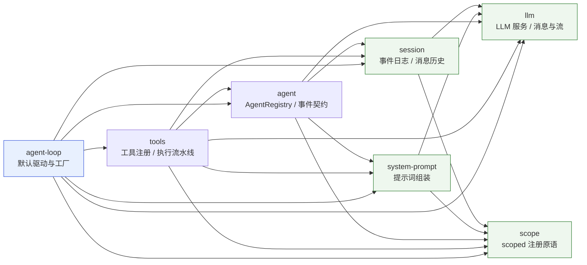
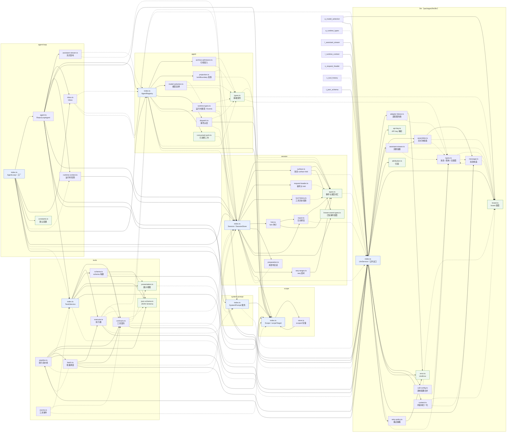
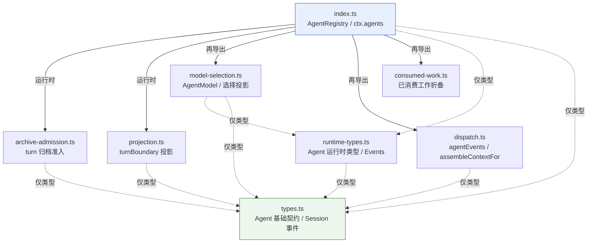
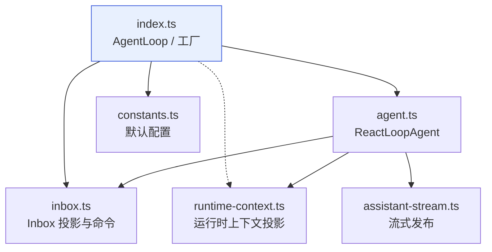
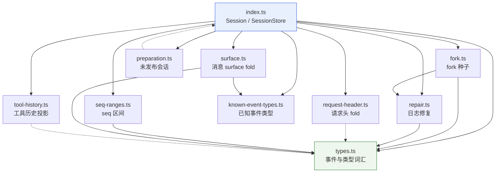
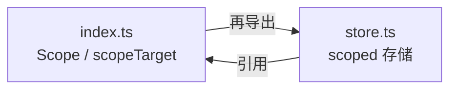
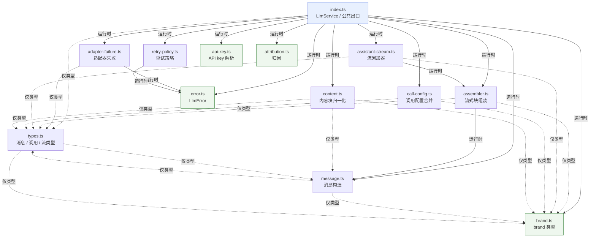
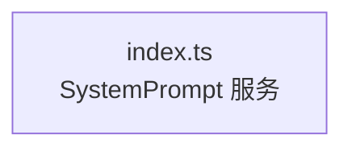
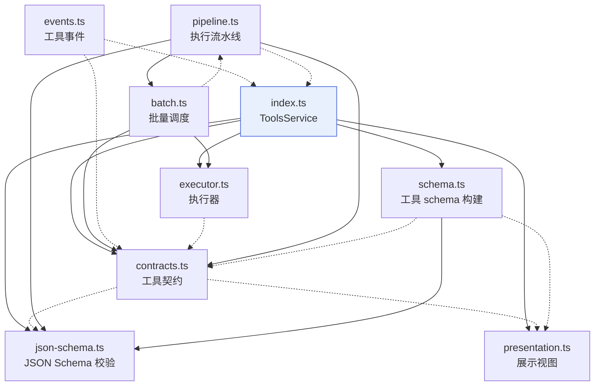

# src/core

从 [deepseek-harness/packages/core](https://github.com/deepseek-ai/deepseek-harness/tree/master/packages/core) 与 [packages/llm/llm](https://github.com/deepseek-ai/deepseek-harness/tree/master/packages/llm/llm) 复制的最小核心源码集。

## 来源

- 仓库：`https://github.com/deepseek-ai/deepseek-harness`
- 提交：`ce7073d51254c26cd63b22a60835b8f948deb447`（`master`）
- 范围：`packages/core` 的 `agent`、`agent-loop`、`session`、`scope`、`system-prompt`、`tools` 六个模块，以及 `packages/llm/llm` 的 `src/*.ts`
- 方式：逐字节复制，未改动任何 import、导出、注释或实现

## 布局

上游每个模块的 `src/` 本身是扁平结构；这里去掉 `src/` 这一层，直接放到 `src/core/<module>/`，不再嵌套多级。

| 模块 | 上游路径 | 本地路径 | 文件数 | 行数 |
| --- | --- | --- | ---: | ---: |
| agent | `packages/core/agent/src` | `src/core/agent` | 8 | 1824 |
| agent-loop | `packages/core/agent-loop/src` | `src/core/agent-loop` | 6 | 2130 |
| session | `packages/core/session/src` | `src/core/session` | 10 | 3353 |
| scope | `packages/core/scope/src` | `src/core/scope` | 2 | 471 |
| system-prompt | `packages/core/system-prompt/src` | `src/core/system-prompt` | 1 | 699 |
| tools | `packages/core/tools/src` | `src/core/tools` | 9 | 3710 |
| llm | `packages/llm/llm/src` | `src/core/llm` | 13 | 4145 |

`llm` 不在 `packages/core`，单独从 `packages/llm/llm` 复制，本地目录同样去掉 `src/` 层。合计 7 个模块、49 个文件、16332 行。

每个 `llm` 源文件的最小使用示例见 [docs/llm](../../docs/llm/)；文件名与源码文件一一对应。

未复制：各模块的 `tests/`、`locale/`、`README*`、`package.json`、`tsconfig.json`、`tsdown.config.ts`。

## 当前状态

- 这些文件仍是上游原文，只作为接口与 Cordis 调用方式的参照。
- 外部依赖保留上游包名（`@deepseek-ai/dsh-*`、`@deepseek-ai/schemastery`、`@deepseek-ai/cosmokit`、`zod` 等）。除 `@deepseek-ai/cordis` 外，本工作区尚未提供这些包，因此这批源码当前不可直接编译。
- 根目录 `tsconfig.json` 的 `include` 也尚未包含 `src/`，不影响现有 `packages/*` 的 typecheck。

## 内部依赖

依赖图覆盖全部 7 个模块、49 个文件。先给出模块总览，再给出一张包含全部文件的全局依赖图，最后按模块展开；三个视图合起来覆盖全部模块和文件。

图中约定：

- 箭头 `A → B` 表示 A 直接依赖 B。
- 实线表示运行时 import 或再导出，虚线表示仅类型引用。
- 模块内部图只画 `./` 文件引用；跨模块引用见“模块总览”。

### 模块总览

跨模块依赖按层排列：`llm`、`scope` 是底座；`session`、`system-prompt` 依赖二者；`agent` 依赖前四者；`tools` 依赖 `agent` 及其下层；`agent-loop` 位于最上层，直接依赖其余六个模块。

### 全局文件依赖图

一张图包含全部 49 个文件。子图按模块分组，跨子图的边就是跨模块依赖；实线表示运行时引用或再导出，虚线表示仅类型引用。

### 文件依赖

#### agent

- `index.ts` 是唯一聚合入口，其余 7 个模块不反向依赖它，依赖图无环。
- `types.ts` 是叶子契约，被 6 个模块依赖（`consumed-work.ts` 除外）。
- `consumed-work.ts` 只依赖 Session 事件类型，内部无依赖，由 `index.ts` 再导出。
- `runtime-types.ts` 以声明合并扩充 `./types.ts` 的 `Agent`，因此两者还有一层隐式类型耦合。

#### agent-loop

- `index.ts` 负责创建与发布 agent；`agent.ts` 是真正的 turn/step 驱动。
- `agent.ts` 同时引用 `runtime-context.ts` 的 `RuntimeContextProjection` 与 `SystemPromptProjection`。
- `assistant-stream.ts`、`inbox.ts`、`runtime-context.ts`、`constants.ts` 之间没有直接的本地文件依赖。

#### session

- `index.ts` 同时是服务实现和 barrel：导入或再导出其余 9 个文件。
- `preparation.ts` 以 `import type { Session }` 回指 `index.ts`，形成仅类型的环；不影响运行时。
- `types.ts` 是最底层的事件与类型词汇，被 6 个文件引用。

#### scope

- 两个文件互相引用：`store.ts` 使用 `index.ts` 的 `scopeChainOf`/`scopeOf`，`index.ts` 再导出 `store.ts`。
- 这是运行时循环引用，依赖 ESM 的 live binding；模块很小，保留这种组织是为了把 scoped 原语集中在一处。

#### llm

- `index.ts` 是唯一聚合入口，导入或再导出其余 12 个文件。
- `types.ts` 与 `message.ts` 构成仅类型的环：`types.ts` 引用消息类型，`message.ts` 反向引用 `types.ts`；运行时不受影响。
- `brand.ts`、`error.ts`、`api-key.ts`、`attribution.ts` 没有本地文件依赖。
- `adapter-failure.ts` 依赖 `error.ts`；`retry-policy.ts` 也复用 `error.ts` 的错误基类。

#### system-prompt

- 只有一个文件，内部没有文件级依赖；依赖来自 `cordis`、`schemastery`，以及本地的 `dsh-scope`、`dsh-llm`。

#### tools

- `index.ts` 是 `ToolsService` 与公共 barrel，导入或再导出 `contracts`、`executor`、`schema`、`json-schema`、`presentation`。
- `pipeline.ts` 与 `batch.ts` 构成类型/再导出方向的环：`batch` 以类型引用 `pipeline`，`pipeline` 再导出 `batch`。
- `events.ts` 以类型方式回指 `index.ts` 的 `ToolsService`，用于声明工具事件。
- `json-schema.ts` 与 `presentation.ts` 是叶子文件，没有本地依赖。

### agent 对外依赖

以下针对 `agent/`；`llm/` 的对外依赖见下一节，其余模块不在本次展开。

#### 已复制的本地模块

| 上游包 | 本地对应 | 导入符号 | 方式 | 引用文件 | 用途 |
| --- | --- | --- | --- | --- | --- |
| `@deepseek-ai/dsh-session`（含 `/types`） | `src/core/session` | `Session`、`SessionEvent`、`SessionId`、`SessionLogOffset`、`EpochHeader`、`AgentCancelCause`、`SessionSeq`、`OptionalSessionSeq`、`UserMessage`、`TurnEndReason` | 仅类型 | `archive-admission.ts`、`consumed-work.ts`、`index.ts`、`model-selection.ts`、`projection.ts`、`runtime-types.ts`、`types.ts` | 会话日志、turn/step 事件、请求头、消息 |
| `@deepseek-ai/dsh-scope` | `src/core/scope` | `scopeTarget`、`Scoped` | 运行时 + 类型 | `dispatch.ts`、`index.ts`、`runtime-types.ts` | Agent 作用域载体与事件过滤 |
| `@deepseek-ai/dsh-system-prompt` | `src/core/system-prompt` | `AssembleContext`；增强 `AssembleContext.agent`、`modelSelection` | 仅类型 | `dispatch.ts`、`runtime-types.ts` | 提示词组装上下文 |
| `@deepseek-ai/dsh-llm`（含 `/brand`、`/types`） | `src/core/llm` | `boundContextSummary`、`createUserMessage`、`ReasoningEffortId`（值）；`ContextFormed`、`LlmAttemptId`、`LlmCallConfig`、`LlmFailure`、`MessageId`、`ResolvedRetryPolicy`、`StreamChunk`、`UserMessage`；增强 `MessageSourceMap` | 运行时 + 类型 | `model-selection.ts`、`runtime-types.ts`、`types.ts` | 用户消息构造、上下文摘要、LLM 流与失败类型 |

#### 其它上游包（本仓库未复制）

| 上游包 | 导入符号 | 方式 | 引用文件 | 用途 |
| --- | --- | --- | --- | --- |
| `@deepseek-ai/dsh-session-projection` | `ProjectionHandle`、`ProjectionDefinition` | 仅类型 | `index.ts`、`model-selection.ts`、`projection.ts` | 投影注册与纯 fold 定义 |
| `@deepseek-ai/dsh-workspace`（含 `/types`） | `SessionActivity`；增强 `SessionActivityKindMap.turn` | 仅类型 | `archive-admission.ts`、`types.ts` | 归档准入回答 |
| `@deepseek-ai/dsh-brand` | `brandNumber` | 运行时 | `projection.ts` | 生成 `SessionSeq` brand |
| `@deepseek-ai/dsh-typert-protocol` | `TypertContext`、`TypertLookup`；增强 `TypertLookupMap.agent`、`TypertContextMap.agent` | 仅类型 | `types.ts` | Agent 的 typert 查询与上下文映射 |
| `@deepseek-ai/dsh-util-values` | `JsonValue` | 仅类型 | `types.ts` | Inbox wire JSON 类型 |

#### 平台与第三方

| 上游包 | 导入符号 | 方式 | 引用文件 | 用途 |
| --- | --- | --- | --- | --- |
| `@deepseek-ai/cordis` | 运行时：`Context`、`Service`、`FiberState`、`getTraceable`、`symbols`；类型：`Fiber`、`Events`；增强 `Context.agents`、`Events`（`agent/*`） | 运行时 + 类型 | `index.ts`、`archive-admission.ts`、`dispatch.ts`、`model-selection.ts`、`runtime-types.ts` | 服务注册、事件派发、effect 生命周期、fiber 状态、可追踪服务 |
| `zod` | `z` | 运行时 | `model-selection.ts`、`projection.ts` | 投影状态 schema |
| `node:async_hooks` | `AsyncLocalStorage` | 运行时 | `index.ts` | initiator 作用域 |
| `node:util/types` | `isPromise` | 运行时 | `index.ts` | 判断 initiator 边界返回值 |

Cordis 的实际调用面集中在 `index.ts`：`Service` 子类与 `super(ctx, 'agents')`、`static inject`、`[Service.init]` 生命周期；`ctx.inject()`、`ctx.on()`、`ctx.effect()`、`ctx.events.dispatch()`、`ctx.serial()`、`ctx.waterfall()`、`ctx.logger`、`ctx.fiber`；`FiberState.UNLOADING`、`getTraceable`、`symbols.original`。此外通过注入的 `ctx.sessionProjections.register()` 使用外部投影服务。

#### 模块增强（声明合并）

这些依赖不出现在 import 符号里，但同样改变外部类型：

| 增强目标 | 增强内容 | 位置 |
| --- | --- | --- |
| `@deepseek-ai/cordis` | `Context.agents`；`Events` 增加 `agent/created`、`agent/disposed`、`agent/status`、`agent/inbox/*`、`agent/pre-step`、`agent/request`、`agent/request-error`、`agent/assistant-stream`、`agent/turn-stopping`、`agent/error` | `index.ts`、`runtime-types.ts` |
| `@deepseek-ai/dsh-session/types` | `SessionEventMap` 增加 `agent/inbox/spliced`、`model/selection` | `types.ts` |
| `@deepseek-ai/dsh-session-projection/types` | `SessionProjectionMap` 增加 `inbox`、`modelSelection` | `types.ts` |
| `@deepseek-ai/dsh-workspace/types` | `SessionActivityKindMap` 增加 `turn` | `types.ts` |
| `@deepseek-ai/dsh-typert-protocol` | `TypertLookupMap.agent`、`TypertContextMap.agent` | `types.ts` |
| `@deepseek-ai/dsh-system-prompt` | `AssembleContext` 增加 `agent`、`modelSelection` | `runtime-types.ts` |
| `@deepseek-ai/dsh-llm` | `MessageSourceMap` 增加 `model-selection` | `model-selection.ts` |

### llm 对外依赖

`llm/` 不依赖其它本地 core 模块，只依赖上游发布包：

| 上游包 | 导入符号 | 方式 | 引用文件 | 用途 |
| --- | --- | --- | --- | --- |
| `@deepseek-ai/cordis` | `Context` | 运行时 | `index.ts` | `LlmService` 的 Cordis 基类 |
| `@deepseek-ai/dsh-attachment` | `AttachmentStore`、`FileAttachmentRef`、`ImageAttachmentRef`、`ImageMediaType`、`RequestImageAttachment`、`ImageRequestTarget` | 仅类型 | `content.ts`、`index.ts`、`types.ts` | 文件/图片附件 |
| `@deepseek-ai/dsh-brand` | `brandString`、`Branded` | 运行时 + 类型 | `assembler.ts`、`brand.ts`、`message.ts`、`types.ts` | branded id 与品牌字符串 |
| `@deepseek-ai/dsh-package-manifest` | `LocalizedText` | 仅类型 | `types.ts` | 本地化文本 |
| `@deepseek-ai/dsh-timeout` | `MAX_TIMER_DELAY_MS` | 运行时 | `retry-policy.ts` | 定时器上限 |
| `@deepseek-ai/dsh-typert-protocol` | `Remote`、`RemoteError`、`TypertRemoteService` | 运行时 | `index.ts` | typert remote 服务 |
| `@deepseek-ai/dsh-util-crypto` | `randomUUID` | 运行时 | `message.ts` | 消息 id 生成 |
| `@deepseek-ai/dsh-util-values` | `assertNever`、`deepFreeze`、`snapshotJsonValue` | 运行时 | `assembler.ts`、`assistant-stream.ts`、`content.ts`、`index.ts`、`message.ts` | 不可变值与穷尽检查 |
| `@deepseek-ai/schemastery` | `z` | 运行时 | `retry-policy.ts` | 重试策略 schema |
| `node:module` | `createRequire` | 运行时 | `attribution.ts` | 读取 package manifest |
